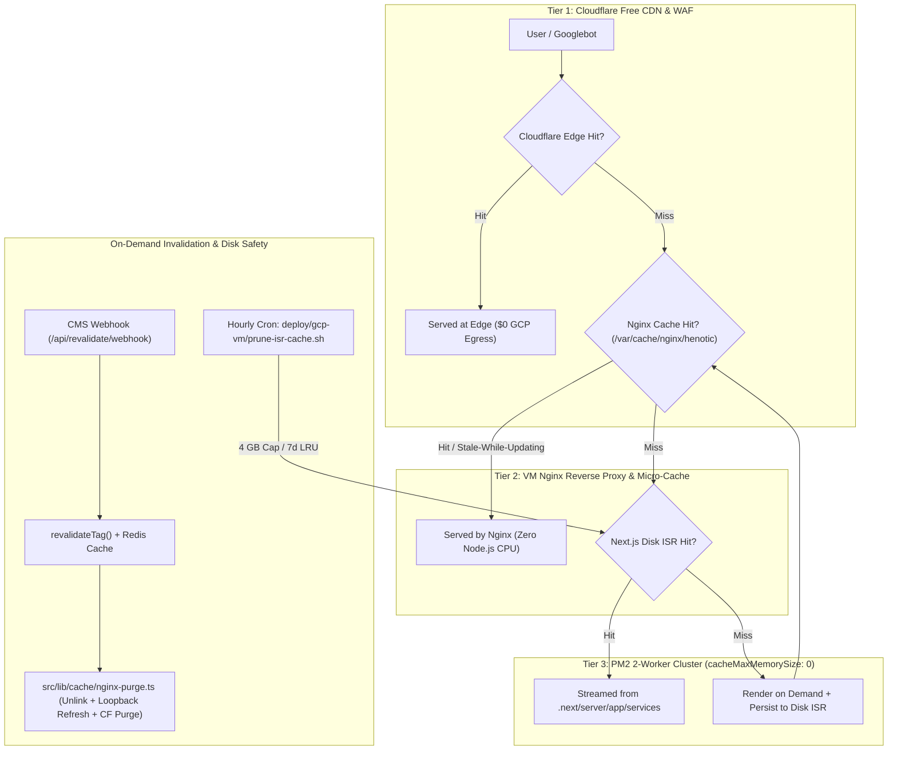

# ISR Scaling Strategy: 45k → 500k URLs

> **Platform**: Henotic Diagnostics (Next.js 16.4 App Router, `output: 'standalone'`)  
> **Hosting & CDN**: GCP Compute Engine VM (`henotic-nextjs-vm`, `asia-south1-c`, Debian 13, 2 vCPU / 8 GB RAM + 4 GB swap, Node 22 LTS, PM2 2-worker cluster) + Nginx micro-cache + Cloudflare Free CDN  
> **Current**: 45,000+ indexed/sitemap URLs, ~610 pre-rendered at build via priority manifest  
> **Target**: 500,000+ PSEO URLs, ~10,000 pre-rendered at build + bounded on-demand ISR  
> **Updated**: 2026-11-22

---

## Table of Contents
1. [Current Architecture Audit](#1-current-architecture-audit)
2. [URL Matrix Math: Scaling to 500k](#2-url-matrix-math-scaling-to-500k)
3. [ISR Architecture Design](#3-isr-architecture-design)
4. [Pre-Build Priority Strategy (Top 10,000)](#4-pre-build-priority-strategy-top-10000)
5. [On-Demand ISR for Remaining 490k](#5-on-demand-isr-for-remaining-490k)
6. [Memory, Disk Cap & Edge Caching (Cloudflare + Nginx + PM2)](#6-memory-disk-cap--edge-caching-cloudflare--nginx--pm2)
7. [Sitemap Scaling Strategy](#7-sitemap-scaling-strategy)
8. [CI/CD Build & Zero-Downtime Release Budget](#8-cicd-build--zero-downtime-release-budget)
9. [Monitoring & Observability](#9-monitoring--observability)
10. [Implementation Roadmap](#10-implementation-roadmap)

---

## 1. Current Architecture Audit

### 1.1 Dynamic Route Inventory

| Route Pattern | File | Build-Time Strategy | Revalidate |
|:---|:---|:---|:---:|
| `/services/[service]` | `src/app/services/[service]/page.tsx` | Priority manifest (`getServicePriorities()`) | `604800s` (7d) |
| `/services/[service]/[region]` | `src/app/services/[service]/[region]/page.tsx` | Priority manifest | `604800s` (7d) |
| `/services/[service]/[region]/[location]` | `src/app/services/[service]/[region]/[location]/page.tsx` | Priority manifest | `604800s` (7d) |
| `/conditions/[condition]` | `src/app/conditions/[condition]/page.tsx` | `generateStaticParams` (sliced) | ISR |
| `/city/[city]` | `src/app/city/[city]/page.tsx` | All configured cities | `604800s` (7d) |
| `/compare/[slug]` | `src/app/compare/[slug]/page.tsx` | All configured comparisons | Static / ISR |
| `/doctors/[slug]` | `src/app/doctors/[slug]/page.tsx` | All configured doctors | Static / ISR |
| `/gmc/[product]` | `src/app/gmc/[product]/page.tsx` | All GMC products | Static / ISR |
| `/services/category/[category]` | `src/app/services/category/[category]/page.tsx` | All categories | Static / ISR |
| `/lp/[service]` | `src/app/lp/[service]/page.tsx` | Dynamic on-demand | Dynamic |

### 1.2 Configuration Data Sources

| Config File | Entries | Purpose |
|:---|:---:|:---|
| `src/config/services.ts` | **400+** | Service slug array (MRI, CT, PET-CT, blood tests, NIPT, genomics, etc.) |
| `src/config/locations.ts` | **5+ regions / 100+ locations** | Geographic matrix |
| `src/config/conditions.ts` | ~30+ | Medical conditions |
| `src/config/cities.ts` | 9 | Top-level city hubs |
| `src/config/comparisons.ts` | ~12 | Service comparison pages |
| `src/config/doctors.ts` | ~12 | Doctor profile pages |
| `src/config/build-priorities.json` | Priority manifest | Top URLs pre-rendered during `npm run build` |

### 1.3 Build-Time Footprint

Currently **~610 pages** are statically pre-rendered during `npm run build` on the GCP VM (using `NODE_OPTIONS="--max-old-space-size=4096"`). Remaining valid URLs in the 45k+ matrix are rendered on demand via Next.js ISR (`dynamicParams = true`) and cached across disk ISR, Nginx micro-cache, and Cloudflare Edge.

---

## 2. URL Matrix Math: Scaling to 500k

### 2.1 Growth Vectors

| Axis | Current | Target | Growth Factor |
|:---|:---:|:---:|:---:|
| **Services** | 400+ | ~800 | ~2× (specialty tests, procedure variants, condition-specific pages) |
| **Regions** | 5–9 | ~25 | ~2.8× (Maharashtra expansion, Goa, Karnataka, Gujarat, Rajasthan) |
| **Locations** | 100+ | ~250 | ~2.5× (tier-2/3 cities, micro-neighborhoods) |

### 2.2 Target URL Breakdown

```
Layer 1: /services/[service]                   =     800
Layer 2: /services/[service]/[region]          =     800 × 25   =    20,000
Layer 3: /services/[service]/[region]/[loc]    =     800 × 250  =   200,000
Layer 4: /conditions/[condition]               =                     ~500
Layer 5: /conditions/[condition]/[region]      =     500 × 25   =    12,500
Layer 6: /conditions/[condition]/[location]    =     500 × 250  =   125,000
Layer 7: /city, /compare, /doctors, /gmc, etc  =                   ~2,000
Layer 8: /lp/[service] (Google Ads, noindex)   =                   ~2,000
Layer 9: /blog/[slug] (CMS-driven)             =                  ~10,000
──────────────────────────────────────────────────────────────────────────
Total                                          ≈                 ~372,800
+ Micro-neighborhoods (/services/[s]/[r]/[l]/[n])                ~127,200
──────────────────────────────────────────────────────────────────────────
Grand Total                                    ≈                 ~500,000
```

### 2.3 Why Generating 500k at Build Time Is Unviable

| Constraint | GCP `e2-standard-2` VM (8 GB RAM, 80 GB SSD) | 500k Build Impact |
|:---|:---|:---|
| Build duration | ~30s–3m target for deploy | 500k pages at 0.1s/page = **13.8 hours** |
| Build memory | `4 GB` Node heap + `4 GB` swap | 500k route objects → OOM risk |
| `/graphql` fetch | WordPress CMS (`cms.henoticdiagnostics.com`) | 500k build-time API calls = self-DDoS on CMS |
| Disk footprint | 80 GB Balanced SSD (`KEEP_RELEASES=2`) | Unbounded pre-build / ISR artifacts exhaust VM disk |

**Conclusion**: Pre-build top priority URLs only, serve long-tail combinations via on-demand ISR, bound VM disk cache via `deploy/gcp-vm/prune-isr-cache.sh`, and absorb crawl bandwidth at Cloudflare Edge + Nginx micro-cache.

---

## 3. ISR Architecture Design

### 3.1 Three-Tier Caching Topology



### 3.2 Core Architecture Principles

| Principle | Implementation |
|:---|:---|
| **Pre-build only what matters** | `src/config/build-priorities.json` + `src/lib/seo/build-priorities.ts` |
| **Shared cluster ISR state** | `cacheMaxMemorySize: 0` in `next.config.js` so PM2 workers 1 & 2 never serve divergent in-memory ISR stale copies |
| **Unoptimized image bypass** | `images: { unoptimized: true }` prevents Next.js `/_next/image` CPU/RAM spikes during 500k Googlebot crawls |
| **Immediate multi-layer invalidation** | WordPress/Payload webhook → `revalidateTag` → `purgeNginxAndEdgeCache()` (direct Nginx MD5 unlink + loopback `127.0.0.1:8081` refresh + optional Cloudflare purge) |
| **Bounded VM disk footprint** | `deploy/gcp-vm/prune-isr-cache.sh` hourly cron evicts oldest route stems atomically (4 GB active cap, 512 MB inactive cap, 80% disk emergency clamp) |
| **Zero-egress edge absorption** | Cloudflare Free absorbs cacheable HTML, `/_next/static/*`, and sitemaps (`$0` GCP egress) |

---

## 4. Pre-Build Priority Strategy (Top 10,000)

### 4.1 Priority Tier System

| Tier | Target Count | Criteria | Source |
|:---|:---:|:---|:---|
| **T1 — Revenue Critical** | ~200 | Services with highest booking volume & Google Ads spend | Analytics + Booking logs |
| **T2 — SEO High-Value** | ~2,000 | Top 50 services × top 40 locations | Google Search Console API |
| **T3 — Geographic Hubs** | ~1,800 | Core services × metro hubs (Navi Mumbai, Mumbai, Thane, Pune) | `src/config/locations.ts` |
| **T4 — Medical Conditions** | ~500 | Condition pages + top regional combos | `src/config/conditions.ts` |
| **T5 — Comparison/Doctors/GMC** | ~500 | Exhaustive compare, doctors, GMC, category pages | Static configs |
| **T6 — Blog/Content** | ~1,000 | Top organic blog articles | WordPress GraphQL |
| **T7 — Backfill** | ~4,000 | Remaining high-impression regional combos | `scripts/generate-build-priorities.ts` |

### 4.2 Manifest-Driven `generateStaticParams`

`src/lib/seo/build-priorities.ts` supplies `getServicePriorities()`, region priorities, and location priorities from `src/config/build-priorities.json`, keeping `npm run build` fast and deterministic while supporting `filterShardParams()` via `scripts/shard-build.ts` when scaling past 10,000 pre-built routes.

---

## 5. On-Demand ISR for Remaining 490k

### 5.1 Slug Validation (Preventing 404 Cache Pollution)

Every dynamic route validates slugs against `O(1)` pre-computed `Set` / `Map` lookups in `src/lib/seo/slug-validator.ts` (`isValidServiceSlug`, `isValidRegionSlug`, `isValidLocationForRegion`, `isValidConditionSlug`), calling `notFound()` immediately on invalid paths. Both Nginx and Cloudflare exclude invalid 404 flooding from polluting warm HTML caches, and `src/proxy.ts` blocks empty UAs, known scrapers, and `/_trap` honeypots with `403`.

---

## 6. Memory, Disk Cap & Edge Caching (Cloudflare + Nginx + PM2)

### 6.1 VM Memory & Process Stability

| Component | Configuration |
|:---|:---|
| **PM2 Cluster** | 2 instances (`ecosystem.config.cjs`), `max_memory_restart: '2G'`, Node 22 LTS |
| **Swap Guard** | 4 GB `/swapfile` (`vm.swappiness=10`) prevents OOM during builds + traffic bursts |
| **Disk Release Retention** | `KEEP_RELEASES=2` in `deploy/gcp-vm/deploy.sh` |
| **Shared Next.js Cache** | `cacheMaxMemorySize: 0` in `next.config.js` forces consistent disk reads across both cluster workers |

### 6.2 Nginx Micro-Cache & ISR Disk Pruner

- **Nginx Micro-Cache (`/var/cache/nginx/henotic`)**: `100m` keys zone, `10g` max size, `24h` inactive, `proxy_cache_valid 200 10m`, `proxy_cache_lock on`, and `proxy_cache_use_stale error timeout updating http_500 http_502 http_503 http_504` — prevents Node.js CPU spikes during Googlebot bursts. Bypassed automatically for RSC/Flight/Prefetch/Action headers and `/api/*`, `/sw.js`, `/booking-system/*`.
- **ISR Disk Pruner (`deploy/gcp-vm/prune-isr-cache.sh`)**: Prevents `.next/server/app/services` from growing unboundedly under 45k–500k long-tail crawls:
  - Active release cap: **4,096 MB** (prunes LRU route stems down to **2,560 MB**).
  - Inactive rollback release cap: **512 MB** (prunes down to **256 MB**).
  - Max cache entry age: **7 days**; emergency clamp to **1,024 MB / 512 MB** if VM disk usage ≥ **80%**.
  - Atomically evicts all sibling route files (`.html`, `.rsc`, `.meta`, `.body`, `.prefetch.rsc`, `.segment.rsc`) together while leaving `.js`, `.json` manifests, and `.next/static` untouched.

### 6.3 Cloudflare Free Edge Layer

- Proxies `@` and `www` (`34.100.203.56`) with SSL **Full (strict)**.
- Serves cacheable HTML, `/_next/static/*`, `/sitemap*.xml`, and public assets from Cloudflare Edge at **\$0 GCP egress** (critical at 500k crawl scale where GCP `asia-south1` egress costs ~\$0.12/GB).
- Respects `Vary: RSC, Next-Router-State-Tree, Next-Router-Prefetch, Next-Url` and bypasses cache for `/api/*`, `/sw.js`, and `/booking-system/*`.

---

## 7. Sitemap Scaling Strategy

`scripts/generate-sitemaps.ts` streams URLs into 10,000-URL XML chunks (`public/sitemaps/sitemap-*.xml`) indexed by `public/sitemap.xml` (plus `sitemap-health-checkups.xml` and `sitemap-nipt-tests.xml`). At 500,000 URLs, this yields 50 chunks (~75 MB total) in ~1.5 seconds without excessive heap usage, served with `Cache-Control: public, max-age=3600, s-maxage=3600, stale-while-revalidate=86400`.

---

## 8. CI/CD Build & Zero-Downtime Release Budget

| Phase | Target Time | Notes |
|:---|:---:|:---|
| GitHub Actions CI (`ci.yml`) | ~2–3 min | Node 22: `npm audit --omit=dev --audit-level=high`, `tsc --noEmit`, Vitest suite, `next build` |
| VM Auto-Deploy (`deploy.yml` → `deploy.sh`) | ~1–2 min | `git reset --hard FETCH_HEAD`, `NODE_OPTIONS="--max-old-space-size=4096" npm run build`, atomic `.live-releases/` symlink swap, `pm2 reload`, health poll (`http://127.0.0.1:3000/api/health`), `prune-isr-cache.sh` |

---

## 9. Monitoring & Observability

| Metric | Source | Alert Threshold |
|:---|:---|:---|
| Health & uptime | `GET https://www.henoticdiagnostics.com/api/health` | Non-200 response |
| Nginx cache efficiency | `X-Cache-Status` (`HIT` / `STALE` / `MISS`), `/var/log/nginx/` | Sustained high `MISS` or `5xx` rate |
| Cloudflare edge offload | Cloudflare Analytics (`Cache Hit Ratio`, `Cached Bandwidth`) | Edge offload < 70% during bot crawls |
| VM disk & ISR cache usage | `df -h /`, `/var/log/pm2/isr-prune.log` | Disk usage ≥ 80% |
| PM2 cluster RAM/CPU | `pm2 status`, `/var/log/pm2/henotic-web-*.log` | Frequent restarts or worker RSS > 1.8 GB |
| Lead & backup durability | `/var/www/henotic-diagnostics/data/*.jsonl`, `/var/log/pm2/backup-leads.log` | Missing daily archive or GCS upload failure |

---

## 10. Implementation Roadmap

### Phase 1: Foundation & GCP VM Migration — ✅ Complete
- [x] Create `src/config/build-priorities.json` and `src/lib/seo/build-priorities.ts`
- [x] Refactor `generateStaticParams` to read from priority manifest
- [x] Add `O(1)` slug validation (`src/lib/seo/slug-validator.ts`) with `notFound()` guards
- [x] Migrate hosting from Vercel to GCP VM (`henotic-nextjs-vm`) with Nginx micro-cache, PM2 cluster (`cacheMaxMemorySize: 0`), Certbot TLS, and Cloudflare Free CDN
- [x] Add bounded ISR disk-cache pruner (`deploy/gcp-vm/prune-isr-cache.sh`), immediate Nginx/Cloudflare webhook purge (`src/lib/cache/nginx-purge.ts`), and daily JSONL backup (`deploy/gcp-vm/backup-leads.sh`)

### Phase 2: Config Expansion — Scale to 100k
- [ ] Expand `src/config/services.ts` from 400+ → 600 services
- [ ] Expand `src/config/locations.ts` from 100+ → 180 locations, 9 → 15 regions
- [ ] Add `/conditions/[condition]/[region]` route layer
- [ ] Update sitemap generator for type-based chunking

### Phase 3: Geographic Expansion — Scale to 300k
- [ ] Expand to 25 regions, 250 locations (Maharashtra, Gujarat, Karnataka, Goa, Rajasthan)
- [ ] Add micro-neighborhood layer (`CITY_MICRO_NEIGHBORHOODS` → route)
- [ ] Implement GSC API sync to auto-update `src/config/build-priorities.json`

### Phase 4: Full Scale — Scale to 500k
- [ ] Expand services to 800
- [ ] Scale blog CMS integration for 10k content URLs
- [ ] Fine-tune revalidation periods & `MAX_ISR_CACHE_MB` disk budget (up to ~10–15 GB if VM SSD is expanded)
- [ ] Provision Upstash Redis across all rate-limiters + automated nightly cache-warmer for top 50k URLs

---

## Appendix A: Quick Reference — Next.js App Router ISR Exports

```typescript
// Pre-build top priority paths at build time
export async function generateStaticParams() {
  return getServicePriorities();
}

// Allow paths NOT in generateStaticParams to be rendered on-demand (default = true)
// Revalidation period in seconds
export const revalidate = 604800; // 7 days
```

## Appendix B: Monthly Infrastructure Cost Profile

| Component | GCP VM + Cloudflare Free |
|:---|:---|
| Compute Engine (`e2-standard-2`, `asia-south1-c`, 80 GB Balanced SSD) | Standard VM instance cost (flat predictable monthly billing, zero per-invocation serverless fees) |
| Bandwidth / Egress (`www` & `@` proxied via Cloudflare Free) | **\$0 GCP egress** on Cloudflare-cached HTML, `/_next/static/*`, and sitemaps; GCP `asia-south1` origin fetch only (~0.12/GB uncached) |
| TLS Certificates & WAF / Bot Mitigation | **\$0** (Certbot Let's Encrypt + Cloudflare Free SSL Full strict + Bot Fight Mode) |
| Lead & Payment Persistence | **\$0** local JSONL + optional MongoDB + GCS archive backup (`backup-leads.sh`) |
