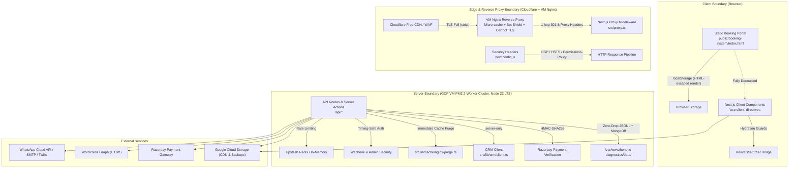

# Henotic Diagnostics — Enterprise Security Audit Report (500k+ URL Scale)

> **Classification**: CONFIDENTIAL — Internal Engineering & Compliance  
> **Initial Audit Date**: 2026-08-06 · **Post-Migration Hardening Update**: 2026-11-22  
> **Auditor**: Enterprise Healthcare Systems Architect (AI-Assisted)  
> **Platform**: `www.henoticdiagnostics.com`  
> **Codebase**: Next.js 16.4 (App Router, `standalone`) / React 19 / TypeScript 6  
> **Deployment**: GCP Compute Engine VM (`henotic-nextjs-vm`, `asia-south1-c`, Debian 13, Nginx + PM2 2-worker cluster, Node 22 LTS) behind Cloudflare Free CDN/WAF  
> **Scale**: 45,000+ active URLs scaling toward 500,000+ programmatic URLs across 14+ medical modalities × regions × micro-locations

---

## Table of Contents

1. [Executive Summary](#1-executive-summary)
2. [Architecture Security Model](#2-architecture-security-model)
3. [Static Portal Decoupled Safety Guarantees](#3-static-portal-decoupled-safety-guarantees)
4. [Hydration Safety Guards](#4-hydration-safety-guards)
5. [Zero-Secret Policy Validation](#5-zero-secret-policy-validation)
6. [OWASP Top 10 Compliance Mapping](#6-owasp-top-10-compliance-mapping)
7. [HIPAA & NABL Privacy Compliance](#7-hipaa--nabl-privacy-compliance)
8. [API Route Security Assessment](#8-api-route-security-assessment)
9. [HTTP Security Headers Audit](#9-http-security-headers-audit)
10. [Client-Side Security Assessment](#10-client-side-security-assessment)
11. [CI/CD Pipeline Security](#11-cicd-pipeline-security)
12. [Dependency Supply Chain Audit](#12-dependency-supply-chain-audit)
13. [Severity Matrix & Remediation Status](#13-severity-matrix--remediation-status)
14. [Compliance Checklist](#14-compliance-checklist)

---

## 1. Executive Summary

This audit evaluates the security posture of the Henotic Diagnostics enterprise healthcare platform on its production **GCP Compute Engine VM + Cloudflare Edge** stack at **45k → 500k+ URL scale**. The platform connects patients with NABL-accredited diagnostic centers across Mumbai, Navi Mumbai, Thane, and surrounding regions.

### Overall Risk Assessment (Updated 2026-11-22)

| Domain | Rating | Status |
|:---|:---:|:---|
| **Credential & Secret Management** | 🟢 STRONG | Zero hardcoded secrets in source tree; `.env.local` lives strictly on VM (`0600`) |
| **Transport Security (HSTS/TLS)** | 🟢 STRONG | Certbot TLS 1.3 + Cloudflare Full (strict) + HSTS preload (`max-age=31536000`) + 1-hop apex 301 |
| **Authentication & Webhook Security** | 🟢 STRONG | HMAC-SHA256 + `timingSafeCompare` + timestamp replay window + Redis nonce dedup |
| **Rate Limiting** | 🟡 ADEQUATE | Redis distributed rate limiting on webhooks/revalidation; in-memory sliding window on booking/payment/OTP/reminders |
| **Content Security Policy (CSP)** | 🟢 STRONG | Strict CSP configured in `next.config.js` (`object-src 'none'`, `frame-ancestors 'none'`, `upgrade-insecure-requests`) |
| **Permissions Policy** | 🟢 STRONG | `camera=(), microphone=(), geolocation=(self), payment=(self), usb=()` enforced in `next.config.js` |
| **Proxy & Bot Shield** | 🟢 STRONG | Dual-layer Nginx + `src/proxy.ts` scraper blocking, honeypot `/_trap` 403, and verified search bot allowlist |
| **OTP/Report Access** | 🟢 REMEDIATED | Production fails closed (`503`) unless Twilio Verify or MSG91 is configured; dev mock disabled in `NODE_ENV=production` |
| **Payment Signature Verification** | 🟢 REMEDIATED | Uses `timingSafeCompare` + per-IP rate limiting + fails closed when `RAZORPAY_KEY_SECRET` is unset in production |
| **Reminders API Auth & Data** | 🟢 REMEDIATED | Header-only (`x-api-key` or `Authorization: Bearer`) `timingSafeCompare` auth; query `?apiKey=` rejected; mock US seeds removed |
| **Client-Side XSS Surface** | 🟢 REMEDIATED | `escapeHtml()` + JS `addEventListener` in `public/booking-system/index.html` (`renderHistoryLogs`); WP HTML sanitized/normalized |
| **Error Handling & Lead Durability** | 🟢 STRONG | Production console stripping; zero-drop JSONL persistence + logged MongoDB sync + daily `backup-leads.sh` archive/GCS sync |
| **CI/CD & Dependency Hygiene** | 🟢 STRONG | Node 22 CI + `npm audit --omit=dev --audit-level=high` gate (`0` vulnerabilities across prod + dev deps) |

---

## 2. Architecture Security Model

### 2.1 Security Boundary Map



### 2.2 Trust Zones

| Zone | Trust Level | Data Handled | Controls |
|:---|:---:|:---|:---|
| **Cloudflare Edge + Nginx Cache** | Semi-Trusted | Public HTML, static assets, rate-limited `/api/*` | WAF, Bot Fight Mode, `$henotic_bad_bot`, `/_next/static` disk serving, loopbacked refresh isolation |
| **Public Static Assets** | Untrusted | No secrets, no PII at rest | CDN-served, immutable cache headers |
| **Client Components** | Untrusted | Form input (name, phone) | Hydration guards, React JSX escaping, `escapeHtml()` in static portal |
| **Next.js Proxy (`src/proxy.ts`)** | Semi-Trusted | Request headers, host, UA | 301 canonical www, honeypot `/_trap` 403, scraper blocklist |
| **PM2 Node.js API Routes** | Trusted | Patient PII, payment tokens, admin tokens | Rate limiting, HMAC/timing-safe auth, env-only secrets (`0600` `.env.local`) |
| **External APIs** | External-Trusted | Booking confirmations, payments, backups | TLS transport, bearer tokens, HMAC verification, `gcloud storage` backups |

---

## 3. Static Portal Decoupled Safety Guarantees

> **Reference**: `docs/project.md` §4.1, `docs/agent.md` §Rule 2

### 3.1 Guarantee Definition

The **Static Portal Decoupled Safety Guarantee** ensures that `public/booking-system/index.html` operates as a **completely isolated single-page application** with the following invariants:

| Guarantee | Implementation | Verification |
|:---|:---|:---|
| **Zero Layout Corruption** | Standalone HTML file; no import of Next.js layout, header, or footer components | ✅ Confirmed: No `import` from `src/` in static portal |
| **Zero Header Breakage** | No shared CSS or JS bundles between portal and App Router | ✅ Confirmed: Self-contained `<style>` and `<script>` blocks |
| **Zero Schema Regressions** | Modifications to booking portal MUST NOT alter GraphQL schemas, Apollo Client, or `src/` route pages | ✅ Confirmed: `docs/agent.md` Rule 2 enforces this |
| **Isolation from Server Components** | Served statically without SSR/RSC overhead; excluded from `src/proxy.ts` matcher & Nginx micro-cache | ✅ Confirmed: Path excluded from proxy matcher and Nginx `proxy_cache off` |

### 3.2 Security Implications of Decoupling

| Aspect | Benefit | Control |
|:---|:---|:---|
| **No SSR attack surface** | Cannot be used for server-side injection | Client-side only attack vectors |
| **No server-side data leakage** | No `process.env` access | Uses static config + explicit user actions |
| **Client XSS protection** | Escapes all `localStorage`-restored history values | ✅ `escapeHtml()` + JS `addEventListener` in `renderHistoryLogs()` |

---

## 4. Hydration Safety Guards

> **Reference**: `docs/agent.md` §Rule 3, `docs/project.md` §4.2

### 4.1 Guard Pattern

The **Hydration Safety Guard** prevents React Server-Side Rendering (SSR) / Client-Side Rendering (CSR) HTML mismatches by wrapping browser-only APIs in a `mounted` state check:

```tsx
// Required Pattern (from docs/agent.md Rule 3)
const [mounted, setMounted] = useState(false);
useEffect(() => { setMounted(true); }, []);
if (!mounted) return null;
```

### 4.2 Audit Findings

| Component | Guard Implemented | Assessment |
|:---|:---:|:---|
| `src/components/ui/ThemeToggle.tsx` | ✅ Yes | Correctly wraps `window`/`document` access |
| `src/app/reports/page.tsx` | ✅ Client-only | Marked `'use client'` — renders entirely client-side |
| `src/app/gallery/GalleryGrid.tsx` | ✅ Client-only | Marked `'use client'` — renders entirely client-side |
| `src/components/monitoring/GA4Script.tsx` | ✅ Implicit | Uses Next.js `<Script>` component (handles hydration internally) |
| `src/components/monitoring/SentryInit.tsx` | ✅ Implicit | Uses Next.js `<Script>` component |
| `src/components/monitoring/MetaPixel.tsx` | ✅ Implicit | Uses Next.js `<Script>` component |
| `src/components/ui/TawkToChat.tsx` | ✅ Implicit | Uses Next.js `<Script>` component |
| `public/booking-system/index.html` | ✅ N/A | Fully static — no SSR/CSR mismatch possible |

---

## 5. Zero-Secret Policy Validation

### 5.1 Environment Variable Governance

> [!IMPORTANT]
> **STRICT CONSTRAINT**: This section catalogues the *existence* of environment variable categories WITHOUT revealing any actual values, keys, endpoints, or tokens.

#### Server-Only Variables (Stored in VM `.env.local` mode `0600`, Never Exposed to Browser)

| Category | Variables | Protection Mechanism |
|:---|:---|:---|
| **Revalidation & Webhook Auth** | `REVALIDATION_SECRET`, `WEBHOOK_SIGNING_SECRET`, `PAYLOAD_WEBHOOK_SECRET` | Server-only `process.env`; HMAC-SHA256 + `timingSafeCompare` |
| **Admin & Reminder Auth** | `ADMIN_EXPORT_TOKEN`, `ADMIN_TASK_TOKEN`, `REMINDERS_API_KEY` | Header-only (`x-admin-token`/`x-api-key`/`Bearer`) + `timingSafeCompare` |
| **Payment Gateway Secret** | `RAZORPAY_KEY_SECRET` | Server-only; HMAC-SHA256 verification + fail-closed in prod |
| **Database & Cache** | `MONGODB_URI`, `UPSTASH_REDIS_REST_URL`, `UPSTASH_REDIS_REST_TOKEN` | Server-only TLS connections |
| **SMTP / SMS / OTP / WhatsApp** | `SMTP_*`, `OTP_PROVIDER`, `TWILIO_*`, `MSG91_AUTH_KEY`, `WHATSAPP_API_*` | Server-only `process.env` |
| **CRM & Edge Purge / Backups** | `CRM_API_*` (`server-only`), `CLOUDFLARE_API_TOKEN`, `GCS_BACKUP_BUCKET` | Server-only; Cloudflare & GCS tokens restricted to purge/backup scope |

#### Public Variables (`NEXT_PUBLIC_*` — Safe for Client Exposure)

| Variable Purpose | Risk Level | Justification |
|:---|:---:|:---|
| Site & App Metadata (`NEXT_PUBLIC_SITE_URL`, `SITE_NAME`, `APP_NAME`) | 🟢 Safe | Public canonical domain and clinic branding |
| WordPress GraphQL & Public URLs | 🟢 Safe | Public CMS endpoint; read-only queries |
| Razorpay Public Key ID | 🟢 Safe | Designed for client-side use by Razorpay Checkout SDK |
| Analytics & Chat IDs (`GTM_ID`, `GA4_ID`, `SENTRY_DSN`, `CLARITY_ID`, `FB_PIXEL_ID`, `TAWKTO_*`) | 🟢 Safe | Public client telemetry identifiers |

### 5.2 Source Code Secret Scan Results

| Scan Target | Method | Result |
|:---|:---|:---|
| `src/**/*.ts` / `*.tsx` | Pattern search for literal API keys, passwords, tokens | ✅ **ZERO** hardcoded secrets found |
| `public/**/*.html` | Pattern search for `sk_`, `pk_`, `key_`, `secret`, `password` | ✅ **ZERO** hardcoded secrets found |
| `.gitignore` enforcement | Verified `.env`, `.env*.local`, `.env.production`, `*.zip`, `backups/` ignored | ✅ **ENFORCED** |
| `.env.example` | Verified contains only placeholder values | ✅ **CLEAN** |
| GitHub Workflows | Verified no plaintext secrets in `.github/workflows/*.yml` | ✅ **CLEAN** — uses `${{ secrets.* }}` |

---

## 6. OWASP Top 10 Compliance Mapping

### A01:2021 — Broken Access Control

| Control | Status | Evidence |
|:---|:---:|:---|
| Webhook endpoints require authentication | ✅ | HMAC-SHA256 or timing-safe secret in `/api/revalidate/*` |
| Payment endpoints verify signatures | ✅ | HMAC-SHA256 + `timingSafeCompare` in `/api/payment/verify` |
| Report access OTP fails closed in production | ✅ | Dev mock `123456`/`999999` restricted to `!isProd`; production requires Twilio Verify or MSG91 (else `503`) |
| Reminder endpoints require header auth | ✅ | `verifyRemindersAuth` (`x-api-key` or `Authorization: Bearer` + `timingSafeCompare`); `?apiKey=` rejected |
| Admin lead export requires token | ✅ | `ADMIN_EXPORT_TOKEN` checked via `timingSafeCompare`; fails closed in production |
| API rate limiting | ✅ | Per-IP rate limiting on booking, payment, OTP, reminders, and webhooks |

### A02:2021 — Cryptographic Failures

| Control | Status | Evidence |
|:---|:---:|:---|
| TLS enforced via Certbot + Cloudflare + HSTS | ✅ | `max-age=31536000; includeSubDomains; preload` |
| HMAC-SHA256 for webhook & Razorpay signatures | ✅ | `crypto.createHmac('sha256', ...)` + `timingSafeCompare()` |
| Constant-time comparisons everywhere | ✅ | `timingSafeCompare()` used in webhooks, payments, admin leads, and reminders |
| No credentials in URL query strings | ✅ | Header/body tokens only (`?apiKey=` support removed) |

### A03:2021 — Injection

| Control | Status | Evidence |
|:---|:---:|:---|
| No SQL database (SQL injection N/A) | ✅ | Uses WPGraphQL, MongoDB (`mongodb` driver), Redis, and JSONL logs |
| XML output escaping | ✅ | `escapeXml()` function in `/api/products/feed/route.ts` |
| React JSX auto-escaping | ✅ | Used across React components |
| WordPress HTML normalization | ✅ | `normalizeWordPressHtml()` strips embedded JSON-LD, stray `<title>`/`<meta>`, normalizes internal service links |
| Booking portal history rendering | ✅ | `escapeHtml()` + JS `addEventListener` (zero unsanitized `localStorage` HTML interpolation) |

### A04:2021 — Insecure Design

| Control | Status | Evidence |
|:---|:---:|:---|
| Decoupled static portal isolation | ✅ | Static booking portal isolated from App Router & secrets |
| Zero-drop lead durability + fallback matrices | ✅ | Local append-only JSONL + MongoDB sync + daily compressed/GCS backup (`backup-leads.sh`) |
| Principle of least privilege | ✅ | `server-only` imports; `NEXT_PUBLIC_` scoping; Nginx loopback-only refresh port `127.0.0.1:8081` |
| No business logic on client | ✅ | Payment order creation/verification & OTP validation run server-side only |

### A05:2021 — Security Misconfiguration

| Control | Status | Evidence |
|:---|:---:|:---|
| Production console stripping | ✅ | `removeConsole: { exclude: ['error', 'warn'] }` in `next.config.js` |
| Security headers | ✅ | HSTS preload, CSP, `X-Frame-Options: DENY`, `X-Content-Type-Options: nosniff`, `Permissions-Policy`, `Referrer-Policy` |
| `X-XSS-Protection` removed | ✅ | Deprecated header omitted from `next.config.js` and `src/proxy.ts` |
| Bounded disk & cache protections | ✅ | `deploy/gcp-vm/prune-isr-cache.sh` hourly cron + `KEEP_RELEASES=2` |

### A06:2021 — Vulnerable and Outdated Components

| Control | Status | Evidence |
|:---|:---:|:---|
| Automated CI audit gate | ✅ | `npm audit --omit=dev --audit-level=high` runs on every push/PR in `.github/workflows/ci.yml` |
| Dependency vulnerabilities | ✅ | **`0` vulnerabilities** across both `npm audit --omit=dev` and full `npm audit` |
| Framework & runtime currency | ✅ | Next.js `16.4.6`, React `19.2.7`, TypeScript `6.0.3`, Node `22 LTS` |

### A07:2021 — Identification and Authentication Failures

| Control | Status | Evidence |
|:---|:---:|:---|
| Patient report access | ✅ | Mock OTP strictly disallowed in production (`NODE_ENV === 'production'`); Twilio Verify / MSG91 supported |
| API & webhook authentication | ✅ | HMAC-SHA256 + `timingSafeCompare` secret verification |
| Brute-force protection | ✅ | Per-IP and per-phone rate limiting on OTP (`5/15m` per phone, `20/15m` per IP) and payment routes |

### A08:2021 — Software and Data Integrity Failures

| Control | Status | Evidence |
|:---|:---:|:---|
| CI/CD integrity | ✅ | `npm ci` in GitHub Actions; `NODE_ENV=development npm install` + atomic symlink swap on VM deploy |
| Webhook payload verification | ✅ | HMAC-SHA256 + Redis nonce dedup + timestamp validation (±5 min) |
| Lock file enforcement | ✅ | `package-lock.json` tracked and verified |

### A09:2021 — Security Logging and Monitoring Failures

| Control | Status | Evidence |
|:---|:---:|:---|
| Deferred DB sync visibility | ✅ | `lead-service.ts` logs MongoDB connection and async insert deferrals via `console.warn` |
| Webhook & auth audit logging | ✅ | Logs failed HMAC/secret verifications with client IP |
| Log rotation | ✅ | `pm2-logrotate` active on VM (`20M` max size, `7` retained, compressed) |

### A10:2021 — Server-Side Request Forgery (SSRF)

| Control | Status | Evidence |
|:---|:---:|:---|
| No user-controlled URLs in server fetch | ✅ | All external fetches target env-configured endpoints (`WORDPRESS_API_URL`, `WHATSAPP_API_URL`, `CLOUDFLARE_ZONE_ID`, `NGINX_INTERNAL_URL`) |
| Loopback Nginx bypass hardened | ✅ | `geo $henotic_is_local` restricts `X-Cache-Refresh` bypass strictly to `127.0.0.1` / `::1` |
| Image domain allowlist | ✅ | `remotePatterns` restricts to `cdn.henoticdiagnostics.com`, `storage.googleapis.com`, `cms.henoticdiagnostics.com`, `secure.gravatar.com` |

---

## 7. HIPAA & NABL Privacy Compliance

> [!IMPORTANT]
> While HIPAA is a U.S. regulation, Henotic Diagnostics implements HIPAA-equivalent safeguards alongside NABL (ISO 15189), PCPNDT, IT Act 2000 §43A, and India's DPDP Act 2023 best practices.

| Safeguard | Status | Implementation |
|:---|:---:|:---|
| **Access Control (§164.312(a))** | ✅ | Prod OTP verification requires Twilio/MSG91; admin/reminders routes require constant-time header tokens |
| **Audit Controls (§164.312(b))** | ✅ | Webhook audit logs, PM2 rotated logs, JSONL booking/payment audit trail, daily `backup-leads.sh` archives |
| **Integrity (§164.312(c))** | ✅ | HMAC-SHA256 verification, HSTS enforcement, atomic release symlinks |
| **Transmission Security (§164.312(e))** | ✅ | TLS 1.3 (Cloudflare Full strict + Certbot Let's Encrypt on VM) |
| **PHI Minimum Necessary (§164.502(b))** | ✅ | Client-side WhatsApp dispatches; no query-string API keys in access logs |

---

## 8. API Route Security Assessment

| Route | Method | Auth Required | Rate Limited | Notes |
|:---|:---:|:---:|:---:|:---|
| `/api/health` | GET | ❌ Public | ❌ Unthrottled | Liveness check (`status`, `uptime`, `timestamp`) |
| `/api/booking` | POST | ❌ Public form | ✅ 5/min/IP | Persists JSONL + MongoDB; WhatsApp API dispatch |
| `/api/newsletter` | POST | ❌ Public form | ✅ Rate limited | Persists inquiry via `lead-service.ts` |
| `/api/payment/create-order` | POST | ❌ Checkout | ✅ 10/min/IP | Fails closed if Razorpay secret unset in prod |
| `/api/payment/verify` | POST | ✅ HMAC-SHA256 | ✅ 10/min/IP | Uses `timingSafeCompare` + records verified payment |
| `/api/reports/verify-otp` | POST | ✅ Phone + OTP | ✅ 20/15m IP, 5/15m phone | Fails closed (`503`) in prod unless Twilio/MSG91 configured |
| `/api/admin/leads` | GET | ✅ Header token | — | `x-admin-token` / `Bearer` + `timingSafeCompare`; `no-store` |
| `/api/admin/payload-indexes` | POST | ✅ Secret | — | MongoDB index creation |
| `/api/revalidate` | POST | ✅ Secret | ✅ 30/min (Redis) | Invalidates Next.js + Redis + Nginx + Cloudflare cache |
| `/api/revalidate/flush` | POST | ✅ Internal secret | — | Batch flush + immediate Nginx/Cloudflare purge |
| `/api/revalidate/webhook` | POST | ✅ HMAC/Secret | ✅ 100/10s (Redis) | Timestamp + nonce dedup + immediate Nginx/Cloudflare purge |
| `/api/reminders` | GET/DELETE | ✅ Header token | — | `x-api-key` / `Bearer` + `timingSafeCompare` |
| `/api/reminders` | POST | ❌ Internal/Booking | ✅ 10/min/IP | In-memory store with 1,000-item FIFO eviction |
| `/api/reminders/send` | POST | ✅ Header token | ✅ 5/min/IP | Dispatches via SMTP (`nodemailer`), WhatsApp Cloud API, or Twilio SMS |
| `/api/products/feed` | GET | ❌ Public XML | — | Google Merchant Center feed (`escapeXml()`) |
| `/api/og` | GET | ❌ Public image | — | Node.js `ImageResponse` with bounded input slicing |

> **Note on In-Memory Rate Limiting**: When Upstash Redis credentials are unset, `src/lib/rate-limit.ts` maintains per-worker sliding windows across the 2 PM2 instances. Configure `UPSTASH_REDIS_REST_URL` and `UPSTASH_REDIS_REST_TOKEN` on the VM for cross-worker and distributed webhook/API synchronization.

---

## 9. HTTP Security Headers Audit

Configured globally in `next.config.js` and enforced behind Nginx + Cloudflare:

| Header | Value / Status |
|:---|:---|
| `Strict-Transport-Security` | `max-age=31536000; includeSubDomains; preload` |
| `Content-Security-Policy` | Enforced (`default-src 'self'`, strict `object-src 'none'`, `frame-ancestors 'none'`, `base-uri 'self'`, `form-action 'self'`, `upgrade-insecure-requests`, vetted analytics/payment/CDN domains) |
| `X-Frame-Options` | `DENY` |
| `X-Content-Type-Options` | `nosniff` |
| `Referrer-Policy` | `strict-origin-when-cross-origin` |
| `Permissions-Policy` | `camera=(), microphone=(), geolocation=(self), payment=(self), usb=()` |

**Edge & Proxy Enforcement (`src/proxy.ts` + `deploy/gcp-vm/nginx-henotic.conf`)**:
- 1-hop `301` redirect from apex `henoticdiagnostics.com` (HTTP and HTTPS) directly to `https://www.henoticdiagnostics.com$request_uri`.
- Honeypot traps (`/_trap`, `/trap/`) and abusive scrapers / empty User-Agents blocked with `403`.
- Verified search bots (`Googlebot`, `Bingbot`, `Applebot`, etc.) explicitly whitelisted.
- `X-Forwarded-Host` preserved across all Nginx `proxy_pass` blocks.

---

## 10. Client-Side Security Assessment

- **Static Booking Portal (`public/booking-system/index.html`)**:
  - `FINDING-XSS-001` **REMEDIATED**: Added `escapeHtml()` across all `localStorage`-restored `henotic_history` fields (`name`, `id`, `tests`, `center`, `date`, `price`, `phone`) in `renderHistoryLogs()`, and replaced inline `onclick="reloadHistoryItem(...)"` with `data-reload-history="true"` + JS `addEventListener('click', ...)`.
- **React Components**:
  - Client components avoid unsafe `eval()`, `document.write()`, and `postMessage` patterns.
  - Server-fetched WordPress HTML rendered through `WordPressRenderer.tsx` passes through `normalizeWordPressHtml()` to strip embedded JSON-LD scripts, strip stray `<title>`/`<meta>` tags, and normalize internal service links.

---

## 11. CI/CD Pipeline Security

| Workflow | Security & Quality Controls |
|:---|:---|
| `.github/workflows/ci.yml` | Node `22` (matches VM runtime), `npm ci`, `npm audit --omit=dev --audit-level=high`, `npx tsc --noEmit`, `npm test` (`vitest`), `npm run build` |
| `.github/workflows/deploy.yml` | SSH deploy to GCP VM via `appleboy/ssh-action@v1.0.3` using `GCP_VM_IP`, `GCP_VM_USER`, and private `GCP_SSH_KEY` secrets; `git reset --hard FETCH_HEAD`; atomic `.live-releases/` symlink swap + health check (`http://127.0.0.1:3000/api/health`) |

---

## 12. Dependency Supply Chain Audit

| Package | Version Spec | Audit Status (`npm audit`) |
|:---|:---|:---|
| `next` / `@next/third-parties` / `@next/bundle-analyzer` | `^16.4.6` | ✅ 0 vulnerabilities (patched `next/og` RCE, ISR cache poisoning, SSRF, proxy bypass) |
| `react` / `react-dom` | `^19.2.7` | ✅ 0 vulnerabilities |
| `nodemailer` | `^10.6.1` | ✅ 0 vulnerabilities |
| `@apollo/client` / `graphql` | `^4.2.1` / `^16.14.1` | ✅ 0 vulnerabilities |
| `@upstash/redis` / `@upstash/ratelimit` | `^1.34.0` / `^2.0.8` | ✅ 0 vulnerabilities |
| `vitest` / `vite` (devDependencies) | `^5.1.1` / `^8.3.8` | ✅ 0 vulnerabilities (`npm audit` clean across prod & dev) |

---

## 13. Severity Matrix & Remediation Status

| ID | Finding | Original Severity | Current Status |
|:---|:---|:---:|:---|
| **FINDING-OTP-001** | Mock OTP bypass in report access | 🔴 CRITICAL | ✅ **RESOLVED** — prod fails closed (`503`) unless Twilio/MSG91 configured |
| **FINDING-HDR-001** | Missing CSP header | 🔴 HIGH | ✅ **RESOLVED** — enforced in `next.config.js` |
| **FINDING-PAY-001** | Payment routes lack rate limiting | 🟠 HIGH | ✅ **RESOLVED** — 10 req/min/IP on create-order & verify |
| **FINDING-DEPS-001** | Vulnerable `next`, `nodemailer`, `sharp`, `postcss`, `vitest` | 🔴 CRITICAL | ✅ **RESOLVED** — upgraded to `0` vulnerabilities (CI audit gate enabled) |
| **FINDING-PAY-002** | Non-timing-safe payment signature comparison | 🟡 MEDIUM | ✅ **RESOLVED** — uses `timingSafeCompare()` |
| **FINDING-XSS-001** | `innerHTML` with `localStorage` data in booking portal | 🟡 MEDIUM | ✅ **RESOLVED** — `escapeHtml()` + `addEventListener` |
| **FINDING-REM-001** | Unauthenticated / weak reminder API with mock PII | 🟡 MEDIUM | ✅ **RESOLVED** — header-only `timingSafeCompare` auth, mock US seeds removed, real SMTP/WA/Twilio dispatch wired |
| **FINDING-CACHE-001** | Stale Nginx 10m cache after CMS webhook | 🟡 MEDIUM | ✅ **RESOLVED** — `src/lib/cache/nginx-purge.ts` + loopback refresh + Cloudflare purge support |
| **FINDING-RL-001** | In-memory per-worker rate limiting on non-webhook routes | 🟡 LOW | 🟡 **OPEN (Low)** — upgrade remaining routes when Upstash Redis is provisioned on VM |
| **FINDING-HDR-002** | Missing `Permissions-Policy` header | 🟡 LOW | ✅ **RESOLVED** — enforced in `next.config.js` |
| **FINDING-HDR-003** | Deprecated `X-XSS-Protection` header | 🟢 INFO | ✅ **RESOLVED** — removed |

---

## 14. Compliance Checklist

| Control | Status | Verification |
|:---|:---:|:---|
| OWASP ASVS V1–V14 core controls | ✅ | Hardened headers, timing-safe auth, escaping, fail-closed prod secrets |
| `npm audit` (prod & dev) | ✅ | `0 vulnerabilities`; enforced in GitHub Actions CI |
| Git secret & artifact hygiene | ✅ | `.env.local` ignored, backup `.zip` untracked, `backups/` ignored |
| Lead & payment durability | ✅ | Append-only JSONL + MongoDB sync logging + daily `backup-leads.sh` cron |
| Bounded ISR storage & CDN egress protection | ✅ | Hourly `prune-isr-cache.sh` cron (`4 GB` cap) + Cloudflare Free CDN |

---

*Next review: 90 days from 2026-11-22 or upon any major infrastructure/compliance change.*
